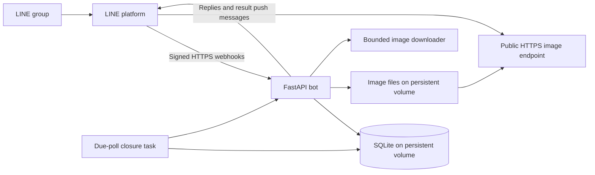

# Implementation plan

Status: Draft for review; application development has not started.

This plan implements the [confirmed requirements](discovery.md). It proposes
the remaining operating rules together so they can be reviewed once. Proposed
rules are not treated as approved requirements.

## Deliverable

A Python/FastAPI LINE group bot, packaged with Docker, that manages each
group's restaurant list and selects lunch using a custom two-choice vote.
SQLite and downloaded images persist on Docker volumes. Local development
uses `docker-compose.yml`; the server uses one standalone
`docker-compose-prod.yml`, without requiring a development override file.

## Confirmed behavior

| Situation | Expected behavior |
| --- | --- |
| Ordinary group conversation | Do not start a lunch selection. |
| Typed `@ginrai` before noon, two or more restaurants | Select two distinct restaurants with equal chances; show images and voting buttons. |
| Typed `@ginrai`, one restaurant before noon | Announce that restaurant directly, explaining only one is available; no vote. |
| Typed `@ginrai` while a poll is open | Show the same choices and buttons; preserve votes and deadline. |
| Vote button | One vote per user per poll; another choice replaces it; repeated taps do not add votes. |
| Deadline | Close voting at 12:00 noon, Asia/Bangkok. |
| Tie or no votes | Select randomly between the poll's choices and explain the fallback. |
| Typed `@ginrai` at or after noon | Show today's result, or explain voting is closed if there is no result. |
| Typed `@ginrai-manage` | Guided Add/Edit/Delete flow inside the group; all group members may use it. |
| Restaurant image input | Accept an HTTPS image URL; backend downloads, validates, stores, and serves the image. |
| Another group uses the bot | Keep catalogs, polls, votes, and management operations separate. |

Actual mention-list support, native LINE polls, a management website, direct
photo uploads, dish catalogs, AI-generated recommendations, and scheduled
creation of polls are outside the confirmed first-release scope.

## Decisions to review together

These are proposed defaults unless explicitly identified as unresolved. Record
the final decisions in card 00 before dependent implementation begins.

| ID | Area | Proposed default / required decision |
| --- | --- | --- |
| D1 | Edge cases and daily selection | Empty list: explain how to add restaurants. One final selection per group per Bangkok calendar day, including a single-restaurant result. Restaurants may appear again on later days. |
| D2 | Result delivery and restaurant changes | Announce results automatically at noon only for polls started by `@ginrai`. Keep poll choices as snapshots so edits/deletions do not change an existing vote. Closing a started poll is separate from creating a scheduled poll. |
| D3 | Management sessions | Isolate sessions by group and user; provide Cancel; expire after 10 minutes of inactivity; confirm deletions; reject blank names and duplicates after trimming/case normalization. Choose message language during review. |
| D4 | Deployment and license | Propose independent deployment using each operator's own LINE credentials. Server hostname, HTTPS termination, and open-source license are unresolved. Do not publish a release before choosing a license. |
| D5 | People and models | Preserve `sol` with high effort for tech lead and `terra` with high effort for developer/tester. Confirm exact available model identifiers, CEO identity, and human manual-testing ownership before starting those roles. No model substitutions are approved. |
| D6 | Workflow and release gate | Propose repo Markdown cards; one round is developer implementation/fix followed by tester verification. Maximum three rounds per card. After a failed third round, create a linked Bug and set the card Pending. Required acceptance failures hold the dependent work/release unless CEO explicitly accepts a reduced scope. |
| D7 | Data and image lifecycle | Propose minimal group/user identifiers without chat transcripts; keep operational poll history until a retention period is agreed. Keep images referenced by current restaurants or retained poll snapshots; clean unreferenced files safely. Agree retention before production. |

## Proposed architecture

Use a small single-server application rather than several independently
deployed application services. The following are implementation proposals.

- Keep webhook parsing/LINE transport separate from restaurant, poll, and vote
  behavior so tests can exercise the real rules without calling LINE.
- Verify the signature over the original request body before processing it.
  Dispatch the full command exactly so `@ginrai-manage` is not mistaken for
  `@ginrai`; accept management replies only in an active session.
- Use SQLite transactions and constraints to enforce group ownership, one open
  poll, one vote per user/poll, and unique webhook processing. Do not rely only
  on process memory for these rules.
- Propose one application worker and one active closer for the initial
  single-server deployment. Store due times in SQLite, scan for due polls, and
  recover them at startup. A process restart must not lose the schedule.
- Persist a poll's winner once. Persist outgoing result work with a stable
  delivery identity and bounded retries. Separate closing the vote from
  successfully sending a message; a LINE outage must not reopen voting or
  cause the winner to be re-randomized. Do not promise exactly-once delivery
  across the network; report unresolved delivery failures.
- Reject vote writes when authoritative server time is at or after the stored
  deadline, even if the closure task has not run. Store instants consistently
  and derive lunch dates/deadlines using Asia/Bangkok. Use an injectable clock
  for deadline tests; decide the handling of late/out-of-order webhooks in 00.
- Use an OS-backed random generator for uniform sampling without replacement;
  do not weight restaurants. Confirm the proposed randomness implementation
  during review; deterministic fake randomness belongs only in tests.
- Use generated image IDs rather than user-supplied filenames. Validate URLs,
  resolved destinations and redirects to reject private/local network access;
  bound time, bytes, redirects, and decoded dimensions. Propose JPEG/PNG input,
  a 5 MB download limit, 10-second fetch timeout, and at most three redirects.
  Validate actual decoded images and strip embedded metadata when re-encoding.
- Store images as files and their references in SQLite. Never expose the
  database or the whole data directory through static hosting. Publish only
  the image endpoint, using opaque names, rather than a catalog API.
- Keep database writes short and image downloads outside write transactions.
  Use atomic file writes and a recoverable cleanup policy for interrupted saves.
  Design backup/restore to preserve both SQLite and referenced image files.

## Proposed data model

| Record | Purpose and constraints |
| --- | --- |
| Group | LINE group identifier and relevant bot membership state. |
| Restaurant | Group owner, display name, source URL, stored image reference, timestamps. |
| Management session | Group/user scope, current step, draft input, expiry, concurrency/version state. |
| Poll | Group, lunch date, state, deadline, chosen result and reason; uniqueness according to D1. |
| Poll choice | Immutable restaurant name/image snapshot tied to its poll. |
| Vote | Poll, voter identity, selected choice, update metadata; unique voter per poll. |
| Webhook receipt/work item | Unique event identity and durable processing state; transactionally coordinated with effects. |
| Outgoing result | Poll, delivery identity, state, attempt count, next retry and last error. |

Database uniqueness alone is not a processing strategy: if webhook work is
acknowledged before it is complete, persist work first and resume it after a
crash. Do not mark an event fully processed before its durable effects exist.

## Development phases and todo list

All task details and dependencies are in the [Kanban board](kanban.md).

| Phase | Cards | Expected demonstration / exit condition |
| --- | --- | --- |
| P0 — Review | 00 | Review remaining defaults and identify the people/models executing the workflow. |
| P1 — Bot and catalog | 01–03 | Start locally; process a signed group command; add, view, edit, and delete group restaurants with persistent images. |
| P2 — Selection and voting | 04–05 | Select eligible choices, handle one restaurant, reuse an open poll, cast and change votes safely. |
| P3 — Noon completion | 06 | Close at Bangkok noon, resolve normal/tie/no-vote outcomes, recover after restart, and deliver a stable result. |
| P4 — Deployment and qualification | 07–09 | Run the standalone production Compose setup, verify isolation/recovery, and give another operator complete setup documentation. |
| P5 — Manual acceptance | 10 | Tech lead and CEO review evidence and record manual UAT and release decisions. |

- [ ] P0: Review card 00 and update this plan with accepted decisions.
- [ ] P1: Complete 01, 02, and 03 through developer/tester review.
- [ ] P2: Complete 04 and 05 through developer/tester review.
- [ ] P3: Complete 06, including restart and boundary-time tests.
- [ ] P4: Complete 07, 08, and 09; verify a clean operator setup.
- [ ] P5: Complete 10 with recorded manual results and defect disposition.

The phases describe delivery milestones, not separate teams. Work the first
card whose dependencies are Done; do not launch agents until roles/models and
the plan are confirmed. There are no date or completion-time commitments yet.

## Validation and completion

Use pytest for meaningful rule/integration tests, signed webhook fixtures,
temporary SQLite databases, isolated image storage, a controlled clock, and a
fake LINE transport. Mock external image fetches for automated tests; reserve
real LINE group checks for manual UAT. Avoid flaky statistical randomness tests:
verify sampling inputs, distinct choices, and fallback behavior deterministically.

Check concurrency, duplicate events, vote updates near noon, stale buttons,
isolation between two groups, hostile/broken image URLs, restart during closure,
and failed outgoing delivery. Validate both Compose configurations and verify
data survives application container replacement. Do not use volume-deleting
commands during persistence acceptance checks.

Each card needs passing acceptance evidence, tester findings, tech-lead review,
and its required manual check. Phase P5 requires the [manual UAT checklist](uat.md)
and the [development workflow](development-workflow.md). No unchecked required
criterion may be silently marked Done.

## Verified platform references

- [LINE webhook handling](https://developers.line.biz/en/docs/messaging-api/receiving-messages/)
  documents signature checking and possible duplicate/out-of-order deliveries.
- [LINE sending messages](https://developers.line.biz/en/docs/messaging-api/sending-messages/)
  documents replies and group push messages. Noon announcements require push
  delivery rather than holding an old reply token; account quotas can affect it.
- [LINE image requirements](https://developers.line.biz/en/reference/messaging-api/#image-message)
  require HTTPS image URLs.
- [Docker volumes](https://docs.docker.com/engine/storage/volumes/) describe
  persistent data outside a container's writable layer. A volume is not a backup.

References checked during planning on 2026-10-15. Runtime and dependency versions
will be pinned and verified when implementation starts.
